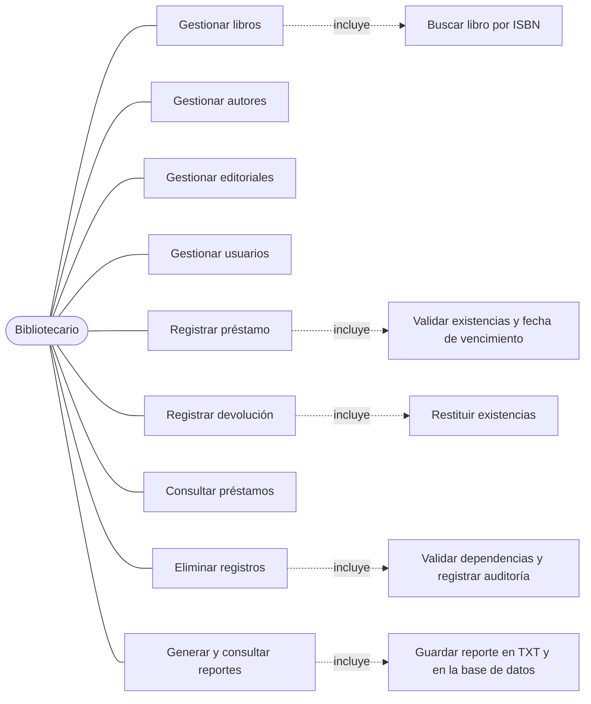
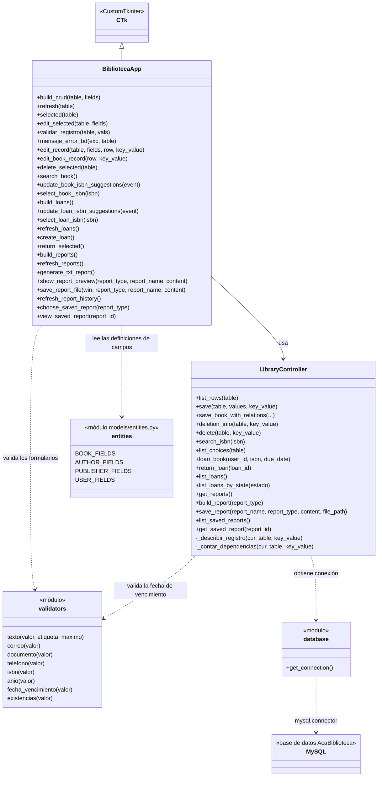
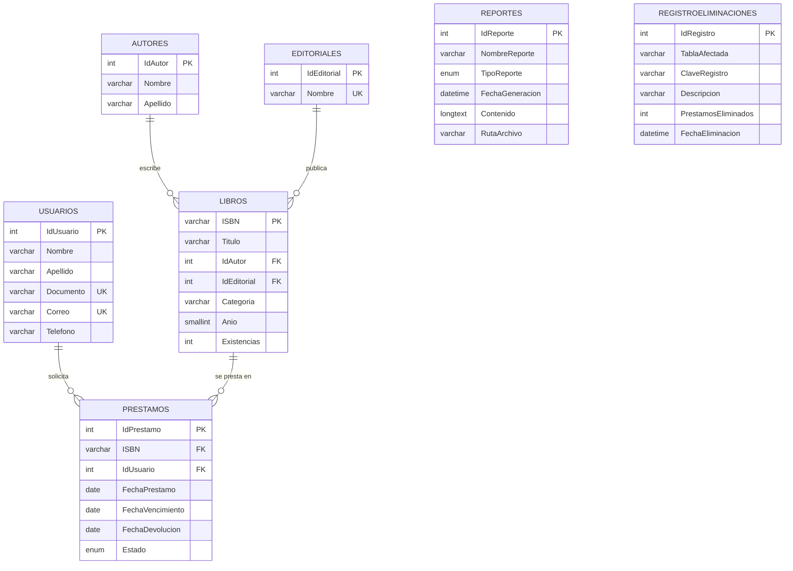
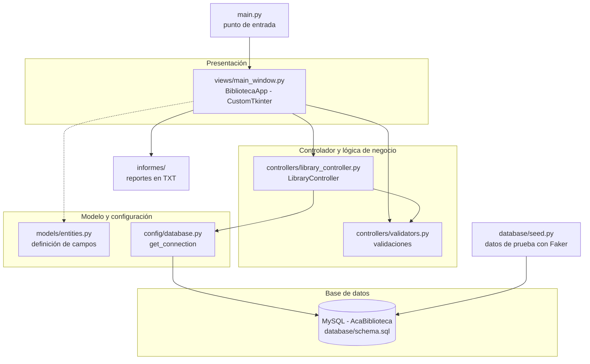
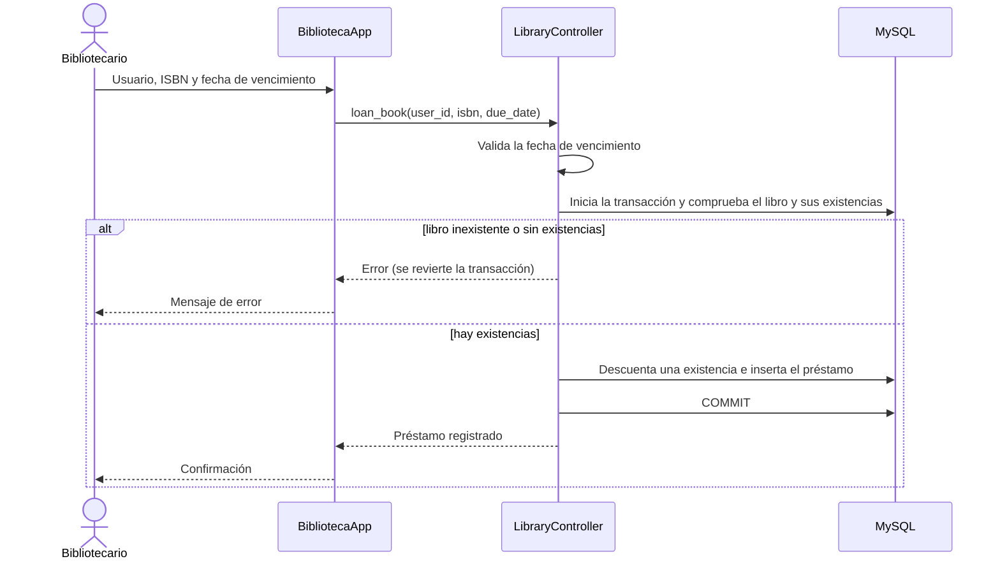

<div align="center">

# Corporación Unificada Nacional de Educación Superior (CUN)

## Ingeniería de Sistemas

### ACA – Programación Avanzada

# Sistema de Gestión de Biblioteca (AcaBiblioteca)

**Presentado por:**

Esteban Correa Peña – Ficha 55563
Daniel Mauricio Castillo Limas – Ficha 54463
David Fernando Pelaez López – Ficha 54463
Otto Alexander Duarte Viloria – Ficha 54465

**Docente:**
Verónica Castro

**Asignatura:**
Programación Avanzada

**Ciudad y fecha:**
Bogotá, Colombia – 10 de noviembre de 2026

</div>

<div style="page-break-after: always;"></div>

<div align="center">

# CONTRAPORTADA

**Sistema de Gestión de Biblioteca – AcaBiblioteca**

Proyecto desarrollado como evidencia de la asignatura **Programación Avanzada**, aplicando Programación Orientada a Objetos, base de datos relacional, arquitectura por capas (MVC), operaciones CRUD, validaciones, manejo de excepciones y conexión con MySQL.

**Tecnologías:** Python · CustomTkinter · MySQL 8.0 · Git y GitHub

**Estudiantes:** Esteban Correa Peña, Daniel Mauricio Castillo Limas, David Fernando Pelaez López y Otto Alexander Duarte Viloria
**Programa:** Ingeniería de Sistemas
**Docente:** Verónica Castro
**Institución:** Corporación Unificada Nacional de Educación Superior (CUN)
**Año:** 2026

Repositorio: https://github.com/davidpelaezl-dot/programacion_avanzada

</div>

<div style="page-break-after: always;"></div>

# TABLA DE CONTENIDO

1. [Introducción](#1-introducción)
2. [Objetivos](#2-objetivos)
3. [Planteamiento del problema](#3-planteamiento-del-problema)
4. [Análisis de requerimientos](#4-análisis-de-requerimientos)
5. [Casos de uso](#5-casos-de-uso)
6. [Diagrama de clases](#6-diagrama-de-clases)
7. [Modelo entidad-relación](#7-modelo-entidad-relación)
8. [Diccionario de datos](#8-diccionario-de-datos)
9. [Arquitectura del sistema](#9-arquitectura-del-sistema)
10. [Explicación de cada módulo desarrollado](#10-explicación-de-cada-módulo-desarrollado)
11. [Capturas de pantalla del sistema](#11-capturas-de-pantalla-del-sistema)
12. [Pruebas de funcionamiento](#12-pruebas-de-funcionamiento)
13. [Conclusiones](#13-conclusiones)
14. [Recomendaciones](#14-recomendaciones)
15. [Referencias bibliográficas](#15-referencias-bibliográficas)

<div style="page-break-after: always;"></div>

# 1. Introducción

El presente documento describe el desarrollo del **Sistema de Gestión de Biblioteca (AcaBiblioteca)**, una aplicación de escritorio cuyo propósito es facilitar la administración de los procesos de una biblioteca: el registro de libros, autores, editoriales y usuarios, el control de préstamos y devoluciones, y la generación de reportes.

El sistema fue desarrollado con **Python**, la biblioteca de interfaz gráfica **CustomTkinter** y la base de datos relacional **MySQL 8.0**, sobre el sistema operativo **Linux Mint**. Se organizó con una **arquitectura por capas (MVC)** que separa la interfaz, la lógica de negocio y el acceso a datos.

La aplicación permite:

- Gestionar libros, autores, editoriales y usuarios mediante operaciones de registro, consulta, modificación y eliminación.
- Registrar un libro junto con su autor y editorial en una sola operación transaccional.
- Registrar préstamos y devoluciones con actualización automática de las existencias y validación de la fecha de vencimiento.
- Eliminar registros con confirmación, validación de dependencias y auditoría en la tabla `RegistroEliminaciones`.
- Generar reportes de inventario, préstamos y devoluciones, guardarlos en formato TXT y registrarlos en la base de datos.
- Traducir los errores frecuentes de MySQL (duplicados, referencias inexistentes y campos obligatorios vacíos) a mensajes comprensibles para el usuario.

Para probar el sistema con un volumen de información realista se desarrolló un generador de datos ficticios con **Faker** (`es_CO`), que permite poblar la base de datos con autores, editoriales, usuarios, libros, préstamos y reportes de ejemplo.

El proyecto corresponde a una **migración** de una aplicación base desarrollada originalmente en C# con Windows Forms y SQL Server. El equipo decidió desarrollarla en Python y MySQL por la mayor comodidad con este lenguaje, por el desconocimiento del lenguaje original y porque los integrantes trabajan en Linux, sistema operativo en el que no se ejecuta la tecnología de la aplicación base.

El documento recoge el planteamiento del problema, los requerimientos, los casos de uso, los diagramas de clases y entidad-relación, el diccionario de datos, la arquitectura, la explicación de los módulos, las capturas de pantalla, las pruebas, las conclusiones y las recomendaciones.

# 2. Objetivos

## 2.1. Objetivo general

Desarrollar una aplicación de escritorio para la gestión de una biblioteca utilizando Python, CustomTkinter y MySQL, que permita administrar libros, autores, editoriales y usuarios, controlar préstamos y devoluciones, y generar reportes, aplicando Programación Orientada a Objetos y una arquitectura por capas.

## 2.2. Objetivos específicos

- Aplicar los principios de la Programación Orientada a Objetos en la organización del código.
- Diseñar e implementar una base de datos relacional en MySQL con claves primarias, claves foráneas y restricciones de integridad.
- Implementar operaciones CRUD sobre libros, autores, editoriales y usuarios.
- Implementar el registro de préstamos y devoluciones con transacciones y bloqueo de filas para mantener coherentes las existencias.
- Implementar validaciones de datos (campos obligatorios, duplicados y fecha de vencimiento) y manejo de excepciones con mensajes comprensibles.
- Implementar la eliminación de registros con confirmación, validación de dependencias y registro de auditoría.
- Generar reportes de inventario, préstamos y devoluciones, y conservar su historial.
- Aplicar una arquitectura por capas que separe la presentación, la lógica de control y el acceso a datos.
- Generar datos de prueba con Faker para verificar el funcionamiento con un volumen realista de información.
- Utilizar Git y GitHub como sistema de control de versiones.
- Documentar técnica y funcionalmente el proyecto.

<div style="page-break-after: always;"></div>

# 3. Planteamiento del problema

## 3.1. Descripción del problema

Una biblioteca institucional maneja a diario información de libros, autores, editoriales, usuarios y préstamos. Cuando esta información se lleva en hojas de cálculo o registros manuales se presentan problemas como:

- Información dispersa y difícil de consultar.
- Registros duplicados de libros, usuarios o editoriales.
- Falta de control sobre qué libros están prestados y cuáles están disponibles.
- Riesgo de inconsistencias, por ejemplo prestar un libro sin existencias, devolver dos veces un mismo préstamo o eliminar un autor que tiene libros asociados.
- Ausencia de un historial de las eliminaciones y de informes que permitan hacer seguimiento al inventario y a los préstamos.

## 3.2. Justificación

Centralizar la información en una base de datos relacional y operarla desde una aplicación de escritorio reduce los errores de digitación, evita duplicados, mantiene actualizadas las existencias de cada libro y permite consultar el estado de los préstamos en cualquier momento. Además, el registro de las eliminaciones y los reportes guardados dejan evidencia de las operaciones realizadas.

El proyecto también permite aplicar en un caso concreto los contenidos de la asignatura: Programación Orientada a Objetos, arquitectura por capas, acceso a bases de datos, validación de datos, transacciones y control de versiones.

## 3.3. Alcance

La aplicación cuenta con seis secciones: **Libros, Autores, Editoriales, Usuarios, Préstamos y Reportes**. El sistema permite:

- Registrar, consultar, modificar y eliminar libros, autores, editoriales y usuarios.
- Registrar un libro junto con su autor y editorial en una sola operación.
- Buscar libros por ISBN y autocompletar el ISBN al registrar un préstamo.
- Registrar préstamos y devoluciones, con actualización automática de las existencias.
- Consultar los préstamos con su estado (activo o devuelto).
- Eliminar registros con confirmación, validación de dependencias y auditoría.
- Generar reportes de inventario, préstamos y devoluciones, guardarlos en TXT y consultar su historial.
- Poblar la base de datos con datos ficticios para pruebas.

## 3.4. Fuera del alcance

- Autenticación de usuarios y manejo de roles.
- Versión web o móvil: es una aplicación de escritorio local.
- Cálculo de multas por retraso en la devolución.
- Exportación de reportes en formatos distintos de TXT.
- Búsqueda de libros por título, autor u otros campos distintos del ISBN.

<div style="page-break-after: always;"></div>

# 4. Análisis de requerimientos

## 4.1. Actores del sistema

| Actor | Descripción |
|---|---|
| Bibliotecario (administrador) | Persona que opera la aplicación: administra libros, autores, editoriales y usuarios, registra préstamos y devoluciones, elimina registros y genera reportes. |

## 4.2. Requerimientos funcionales

| Código | Requerimiento | Descripción |
|---|---|---|
| RF01 | Gestión de libros | Registrar, consultar, modificar y eliminar libros; buscar por ISBN; mostrar autor y editorial asociados; registrar el libro junto con su autor y editorial (`save_book_with_relations()`). |
| RF02 | Gestión de autores | Registrar, consultar, modificar y eliminar autores; validar dependencias antes de eliminar. |
| RF03 | Gestión de editoriales | Registrar, consultar, modificar y eliminar editoriales; validar dependencias antes de eliminar. |
| RF04 | Gestión de usuarios | Registrar, consultar, modificar y eliminar usuarios; validar campos obligatorios y documentos o correos duplicados. |
| RF05 | Registro de préstamos | Registrar préstamos validando que el libro exista, que haya existencias y que la fecha de vencimiento sea válida; la existencia del usuario la garantiza la clave foránea de la base de datos; descontar una existencia (`loan_book()`). |
| RF06 | Registro de devoluciones | Registrar la devolución, restablecer la existencia y evitar devolver dos veces el mismo préstamo (`return_loan()`). |
| RF07 | Consulta de préstamos | Listar los préstamos con su estado, fechas de vencimiento y devolución (`list_loans()`); el controlador también permite consultarlos por estado (`list_loans_by_state()`). |
| RF08 | Eliminación con auditoría | Eliminar registros con confirmación y registrar cada eliminación en `RegistroEliminaciones`. |
| RF09 | Reportes | Generar reportes de inventario, préstamos y devoluciones; guardarlos en TXT y en la base de datos; consultar el historial. |
| RF10 | Datos de prueba | Generar datos ficticios colombianos con Faker mediante `database/seed.py`. |
| RF11 | Navegación | Ventana principal con secciones para Libros, Autores, Editoriales, Usuarios, Préstamos y Reportes. |

## 4.3. Requerimientos no funcionales

| Código | Requerimiento | Descripción |
|---|---|---|
| RNF01 | Usabilidad | La interfaz debe ser clara y sus mensajes y etiquetas deben estar en español. |
| RNF02 | Validación | El sistema valida campos obligatorios, duplicados y la fecha de vencimiento (`controllers/validators.py`). |
| RNF03 | Mensajes comprensibles | Los errores de MySQL (1062, 1452 y 1048) se traducen a mensajes claros (`mensaje_error_bd()`). |
| RNF04 | Arquitectura | Se aplica una arquitectura por capas (MVC): vistas, controladores, configuración y base de datos. |
| RNF05 | Integridad de los datos | Claves foráneas, restricciones de unicidad y transacciones con `commit` y `rollback`. |
| RNF06 | Manejo de excepciones | Las operaciones capturan los errores y revierten la transacción cuando fallan. |
| RNF07 | Configuración segura | Los parámetros de conexión se leen de variables de entorno; el archivo `.env` no se publica en el repositorio. |
| RNF08 | Portabilidad | La aplicación se ejecuta en Linux Mint con un entorno virtual de Python (`venv`). |
| RNF09 | Mantenibilidad | Código organizado por responsabilidades y modificado de forma puntual, con copia de seguridad antes de cada cambio. |

## 4.4. Reglas de negocio

| Código | Regla | Dónde se aplica |
|---|---|---|
| RN01 | El ISBN de un libro es único. | Clave primaria de `Libros`. |
| RN02 | El documento y el correo de un usuario son únicos. | Restricciones `UNIQUE` y validación en el controlador. |
| RN03 | El nombre de una editorial es único. | Restricción `UNIQUE` en `Editoriales`. |
| RN04 | No se permiten campos obligatorios vacíos. | Validaciones de la vista y del controlador. |
| RN05 | No se registra un préstamo si el libro no existe ni si el usuario no existe. | `loan_book()` valida el libro; la clave foránea `fk_prestamos_usuarios` rechaza al usuario inexistente y la transacción se revierte. |
| RN06 | No se presta un libro sin existencias disponibles. | `loan_book()`. |
| RN07 | Al prestar, las existencias bajan en 1 y el préstamo queda activo. | `loan_book()`, dentro de una transacción con bloqueo. |
| RN08 | La fecha de vencimiento debe tener el formato AAAA-MM-DD y no puede ser anterior al día actual. | `fecha_vencimiento()` en `validators.py`. |
| RN09 | Al devolver, el préstamo pasa a devuelto y las existencias suben en 1. | `return_loan()`. |
| RN10 | Un préstamo ya devuelto no se puede devolver de nuevo. | `return_loan()`. |
| RN11 | Un autor o una editorial con libros asociados no se puede eliminar. | Validación de dependencias y claves foráneas. |
| RN12 | Para eliminar un libro con préstamos activos se debe escribir `ELIMINAR` como confirmación. | Ventana de autorización de la interfaz. |
| RN13 | Toda eliminación de un registro, de cualquier tabla, queda registrada en `RegistroEliminaciones`. | `delete()`, dentro de una transacción. |
| RN14 | Registrar un libro junto con su autor y editorial es una operación única: si algo falla, no queda ningún registro incompleto. | `save_book_with_relations()`. |

<div style="page-break-after: always;"></div>

# 5. Casos de uso

## 5.1. Descripción

El único actor del sistema es el **bibliotecario**, quien opera la aplicación desde la ventana principal. Los casos de uso corresponden a las seis secciones de la interfaz y a las operaciones que se realizan en cada una.

## 5.2. Diagrama de casos de uso



## 5.3. Descripción de los casos de uso

### CU01 – Gestionar libros

| Campo | Descripción |
|---|---|
| Actor | Bibliotecario |
| Precondición | La aplicación está abierta y conectada a MySQL. |
| Flujo principal | 1. El actor abre la sección **Libros**. 2. El sistema lista los libros con su autor y editorial. 3. El actor selecciona registrar o modificar un libro. 4. Ingresa ISBN, título, categoría, año y existencias. 5. Elige un autor y una editorial existentes o registra nuevos. 6. Guarda el libro. 7. El sistema valida los datos, guarda el libro (y el autor y la editorial nuevos, si los hay) en una sola transacción y actualiza el listado. |
| Flujos alternos | A1. Campos obligatorios vacíos o con formato inválido: el sistema muestra el mensaje y no guarda. A2. ISBN duplicado: el sistema muestra un mensaje de registro duplicado (error 1062). A3. Referencia inexistente: mensaje de error 1452. A4. Si falla cualquier paso, la transacción se revierte y no queda ningún registro incompleto. |
| Postcondición | El libro queda registrado o actualizado con su autor y su editorial. |

### CU02 – Gestionar autores, CU03 – Editoriales y CU04 – Usuarios

Siguen el mismo flujo de registro, consulta y modificación desde su sección:

| Caso de uso | Campos | Validaciones |
|---|---|---|
| Autores | Nombre, apellido | Obligatorios. |
| Editoriales | Nombre | Obligatorio y único. |
| Usuarios | Nombre, apellido, documento, correo, teléfono | Obligatorios; documento y correo no pueden estar duplicados. |

### CU05 – Registrar préstamo

| Campo | Descripción |
|---|---|
| Actor | Bibliotecario |
| Precondición | Existe al menos un usuario y un libro con existencias. |
| Flujo principal | 1. El actor abre la sección **Préstamos**. 2. Digita el ID del usuario, el ISBN del libro (con autocompletado) y la fecha de vencimiento (`AAAA-MM-DD`). 3. Registra el préstamo. 4. El sistema valida la fecha de vencimiento, bloquea la fila del libro y comprueba que exista y que tenga existencias. 5. Descuenta una existencia e inserta el préstamo como activo, dentro de una transacción con bloqueo. 6. Muestra la confirmación y actualiza el listado. |
| Flujos alternos | A1. Fecha con formato incorrecto o anterior a hoy: se rechaza. A2. Libro inexistente: se rechaza con el mensaje «No existe el libro seleccionado». A3. Libro sin existencias: se rechaza con el mensaje «No hay existencias disponibles». A4. Usuario inexistente: la base de datos rechaza el préstamo por la clave foránea (error 1452), la aplicación muestra un mensaje de referencia inexistente y la transacción se revierte. En todos los casos las existencias no cambian. |
| Postcondición | Préstamo activo; existencias del libro reducidas en 1. |

### CU06 – Registrar devolución

| Campo | Descripción |
|---|---|
| Actor | Bibliotecario |
| Precondición | Existe un préstamo activo. |
| Flujo principal | 1. El actor selecciona el préstamo en la tabla. 2. Registra la devolución. 3. El sistema marca el préstamo como devuelto, guarda la fecha de devolución y suma una existencia al libro, dentro de una transacción. 4. Muestra la confirmación y actualiza el listado. |
| Flujos alternos | A1. Sin selección: advertencia. A2. Préstamo ya devuelto: el sistema lo rechaza. |
| Postcondición | Préstamo devuelto; existencias del libro aumentadas en 1. |

### CU07 – Consultar préstamos

El actor abre la sección **Préstamos** y el sistema lista los préstamos, del más reciente al más antiguo, con el libro, el usuario, la fecha de préstamo, la fecha de vencimiento, la fecha de devolución y el estado.

### CU08 – Eliminar registros

| Campo | Descripción |
|---|---|
| Actor | Bibliotecario |
| Precondición | Hay un registro seleccionado en la sección correspondiente. |
| Flujo principal | 1. El actor selecciona el registro y pide eliminarlo. 2. El sistema calcula las dependencias del registro. 3. Muestra una ventana de confirmación con la información de lo que se eliminará. 4. El actor confirma. 5. El sistema elimina el registro en una transacción y guarda en `RegistroEliminaciones` la tabla afectada, la clave, la descripción, los préstamos eliminados y la fecha. |
| Flujos alternos | A1. Autor o editorial con libros asociados: el sistema no permite eliminarlo. A2. Libro con préstamos activos: se debe escribir `ELIMINAR` para continuar. A3. El actor cancela: no se elimina nada. A4. Si la operación falla, se revierte la transacción. |
| Postcondición | El registro queda eliminado y la eliminación queda auditada. |

### CU09 – Generar y consultar reportes

| Campo | Descripción |
|---|---|
| Actor | Bibliotecario |
| Precondición | La aplicación está conectada a MySQL. |
| Flujo principal | 1. El actor abre la sección **Reportes**. 2. Elige el tipo de reporte: inventario, préstamos o devoluciones. 3. El sistema construye el reporte y muestra una vista previa. 4. El actor lo guarda. 5. El sistema escribe el archivo TXT en la carpeta `informes/` y registra el reporte en la tabla `Reportes`. |
| Flujos alternos | A1. El actor consulta el historial de reportes guardados y abre uno anterior. |
| Postcondición | El reporte queda guardado en un archivo y en la base de datos. |

<div style="page-break-after: always;"></div>

# 6. Diagrama de clases

## 6.1. Descripción

La aplicación se organiza alrededor de dos clases: la ventana principal **`BibliotecaApp`** (capa de presentación, en `views/main_window.py`) y el controlador **`LibraryController`** (capa de lógica y acceso a datos, en `controllers/library_controller.py`). Las validaciones de datos están en funciones del módulo `controllers/validators.py`, las definiciones de los campos de cada entidad en `models/entities.py` y la conexión con MySQL en `config/database.py`.

## 6.2. Diagrama de clases



## 6.3. Principales clases y módulos

| Clase o módulo | Responsabilidad |
|---|---|
| `BibliotecaApp` | Ventana principal. Construye las secciones, muestra tablas y formularios, valida los datos de entrada, traduce los errores de MySQL a mensajes comprensibles y pide confirmación antes de eliminar. |
| `LibraryController` | Reglas de negocio y acceso a datos: consultas, guardado, eliminación con auditoría, búsqueda por ISBN, préstamos, devoluciones y reportes, con transacciones. |
| `validators` | Funciones que validan texto, correo, documento, teléfono, ISBN, año, fecha de vencimiento y existencias. La vista las usa en los formularios y el controlador usa `fecha_vencimiento()` al registrar un préstamo. |
| `entities` | Módulo `models/entities.py` con las definiciones de los campos de libros, autores, editoriales y usuarios, que la vista usa para construir los formularios. |
| `database` | Crea la conexión con MySQL con `get_connection()`. |
| `database/seed.py` | Script independiente que genera datos ficticios con Faker (`es_CO`). |

## 6.4. Conceptos de POO aplicados

| Concepto | Aplicación en el proyecto |
|---|---|
| Clases y objetos | `BibliotecaApp` y `LibraryController`; al iniciar, la aplicación crea una instancia de cada una. |
| Constructor | `BibliotecaApp.__init__` construye la ventana, las secciones y el controlador. |
| Herencia | `BibliotecaApp` hereda de `ctk.CTk`, la ventana principal de CustomTkinter. |
| Encapsulamiento | El acceso a la base de datos queda dentro del controlador; los métodos auxiliares `_describir_registro` y `_contar_dependencias` son de uso interno (prefijo `_`). |
| Métodos | La vista agrupa las operaciones de interfaz y el controlador las de datos y reglas de negocio. |
| Colecciones | Listas, tuplas y diccionarios para filas, campos y opciones de las tablas. |
| Separación de responsabilidades | Vista, controlador, validaciones y configuración están en módulos distintos (MVC). |

> **Observación:** las entidades (libro, autor, usuario, préstamo) no tienen clases propias; se manejan como filas y diccionarios. Convertirlas en clases (`Libro`, `Autor`, `Usuario`, `Prestamo`) sería una mejora que reforzaría la evidencia de POO (ver recomendaciones).

<div style="page-break-after: always;"></div>

# 7. Modelo entidad-relación

## 7.1. Descripción

El modelo de datos se compone de siete tablas. Cinco de ellas (`Autores`, `Editoriales`, `Usuarios`, `Libros` y `Prestamos`) almacenan la información de la biblioteca y están relacionadas mediante claves foráneas. Las otras dos (`Reportes` y `RegistroEliminaciones`) son tablas de apoyo: guardan el historial de reportes generados y la auditoría de las eliminaciones, y no tienen claves foráneas.

## 7.2. Diagrama entidad-relación



## 7.3. Relaciones principales

| Relación | Cardinalidad | Descripción | Al eliminar el registro principal |
|---|---|---|---|
| Autores – Libros | 1:N | Un autor puede tener varios libros; cada libro tiene un autor. | Se impide (`RESTRICT`). |
| Editoriales – Libros | 1:N | Una editorial publica varios libros; cada libro pertenece a una editorial. | Se impide (`RESTRICT`). |
| Usuarios – Préstamos | 1:N | Un usuario puede tener varios préstamos; cada préstamo es de un usuario. | Se eliminan sus préstamos (`CASCADE`). |
| Libros – Préstamos | 1:N | Un libro puede aparecer en varios préstamos; cada préstamo es de un libro, identificado por su ISBN. | Se eliminan sus préstamos (`CASCADE`). |

La relación entre usuarios y libros es de muchos a muchos y se resuelve con la tabla `Prestamos`. Como cada préstamo corresponde a un solo libro, el modelo no requiere una tabla adicional de detalle de préstamos. La categoría del libro se guarda como texto en la tabla `Libros`; no existe una tabla de categorías.

Las tablas `Reportes` y `RegistroEliminaciones` no se relacionan con las demás mediante claves foráneas, por lo que sus registros se conservan aunque se eliminen los datos a los que hacen referencia. Cuando se elimina un libro o un usuario con préstamos, la cantidad de préstamos eliminados queda anotada en el campo `PrestamosEliminados`.

<div style="page-break-after: always;"></div>

# 8. Diccionario de datos

Base de datos: `AcaBiblioteca` · Motor: InnoDB · Codificación: `utf8mb4` (`utf8mb4_unicode_ci`). Fuente: `database/schema.sql`.

## 8.1. Convenciones

| Abreviatura | Significado |
|---|---|
| PK | Clave primaria |
| FK | Clave foránea |
| UQ | Campo con valor único |
| Sí / No (columna Nulo) | Indica si el campo admite valores nulos |

## 8.2. Tabla `Autores`

| Campo | Tipo de dato | Nulo | Clave / restricción | Descripción |
|---|---|---|---|---|
| IdAutor | INT AUTO_INCREMENT | No | PK | Identificador único del autor. |
| Nombre | VARCHAR(100) | No | Índice `idx_autor_nombre` (Nombre, Apellido) | Nombre del autor. |
| Apellido | VARCHAR(100) | No | Incluido en el índice anterior | Apellido del autor. |

## 8.3. Tabla `Editoriales`

| Campo | Tipo de dato | Nulo | Clave / restricción | Descripción |
|---|---|---|---|---|
| IdEditorial | INT AUTO_INCREMENT | No | PK | Identificador único de la editorial. |
| Nombre | VARCHAR(160) | No | UQ | Nombre de la editorial. |

## 8.4. Tabla `Usuarios`

| Campo | Tipo de dato | Nulo | Clave / restricción | Descripción |
|---|---|---|---|---|
| IdUsuario | INT AUTO_INCREMENT | No | PK | Identificador único del usuario. |
| Nombre | VARCHAR(100) | No | | Nombre del usuario. |
| Apellido | VARCHAR(100) | No | | Apellido del usuario. |
| Documento | VARCHAR(40) | No | UQ | Documento de identidad. |
| Correo | VARCHAR(180) | No | UQ | Correo electrónico. |
| Telefono | VARCHAR(40) | No | | Teléfono de contacto. |

## 8.5. Tabla `Libros`

| Campo | Tipo de dato | Nulo | Clave / restricción | Descripción |
|---|---|---|---|---|
| ISBN | VARCHAR(20) | No | PK | Código ISBN; identifica al libro. |
| Titulo | VARCHAR(240) | No | Índice `idx_libros_titulo` | Título del libro. |
| IdAutor | INT | No | FK → Autores(IdAutor) | Autor del libro. |
| IdEditorial | INT | No | FK → Editoriales(IdEditorial) | Editorial del libro. |
| Categoria | VARCHAR(100) | No | | Categoría del libro (texto). |
| Anio | SMALLINT | No | | Año de publicación. |
| Existencias | INT | No | DEFAULT 0; `CHECK (Existencias >= 0)` | Ejemplares disponibles. |

## 8.6. Tabla `Prestamos`

| Campo | Tipo de dato | Nulo | Clave / restricción | Descripción |
|---|---|---|---|---|
| IdPrestamo | INT AUTO_INCREMENT | No | PK | Identificador único del préstamo. |
| ISBN | VARCHAR(20) | No | FK → Libros(ISBN) | Libro prestado. |
| IdUsuario | INT | No | FK → Usuarios(IdUsuario); índice `idx_prestamos_usuario` | Usuario que recibe el libro. |
| FechaPrestamo | DATE | No | | Fecha en que se registra el préstamo. |
| FechaVencimiento | DATE | No | | Fecha límite de devolución. |
| FechaDevolucion | DATE | Sí | | Fecha de devolución; vacía mientras el préstamo siga activo. |
| Estado | ENUM('Prestado','Devuelto') | No | DEFAULT 'Prestado'; índice `idx_prestamos_estado` | Estado del préstamo. |

## 8.7. Tabla `Reportes`

| Campo | Tipo de dato | Nulo | Clave / restricción | Descripción |
|---|---|---|---|---|
| IdReporte | INT AUTO_INCREMENT | No | PK | Identificador único del reporte. |
| NombreReporte | VARCHAR(150) | No | | Nombre con el que se guarda el reporte. |
| TipoReporte | ENUM('Inventario','Préstamos','Devoluciones') | No | | Tipo de reporte generado. |
| FechaGeneracion | DATETIME | No | DEFAULT CURRENT_TIMESTAMP | Fecha y hora de generación. |
| Contenido | LONGTEXT | No | | Texto completo del reporte. |
| RutaArchivo | VARCHAR(500) | Sí | | Ruta del archivo TXT guardado en `informes/`. |

## 8.8. Tabla `RegistroEliminaciones`

| Campo | Tipo de dato | Nulo | Clave / restricción | Descripción |
|---|---|---|---|---|
| IdRegistro | INT AUTO_INCREMENT | No | PK | Identificador único del registro de auditoría. |
| TablaAfectada | VARCHAR(30) | No | | Tabla de la que se eliminó el registro. |
| ClaveRegistro | VARCHAR(50) | No | | Clave del registro eliminado (por ejemplo, el ISBN o el identificador). |
| Descripcion | VARCHAR(255) | No | | Descripción del registro eliminado. |
| PrestamosEliminados | INT | No | DEFAULT 0 | Cantidad de préstamos eliminados junto con el registro. |
| FechaEliminacion | DATETIME | No | DEFAULT CURRENT_TIMESTAMP | Fecha y hora de la eliminación. |

## 8.9. Claves foráneas

Todas tienen `ON UPDATE CASCADE`. Lo que cambia es el comportamiento al eliminar:

| Clave foránea | Origen | Destino | `ON DELETE` |
|---|---|---|---|
| fk_libros_autores | Libros.IdAutor | Autores.IdAutor | RESTRICT |
| fk_libros_editoriales | Libros.IdEditorial | Editoriales.IdEditorial | RESTRICT |
| fk_prestamos_libros | Prestamos.ISBN | Libros.ISBN | CASCADE |
| fk_prestamos_usuarios | Prestamos.IdUsuario | Usuarios.IdUsuario | CASCADE |

Con `RESTRICT` no se puede eliminar un autor o una editorial que tenga libros. Con `CASCADE`, al eliminar un libro o un usuario se eliminan también sus préstamos; por eso la aplicación pide confirmación antes de hacerlo y registra la operación en `RegistroEliminaciones`.

> **Nota:** el script `schema.sql` crea la base de datos, las tablas, las claves y las restricciones. Los datos de prueba se generan por separado con `database/seed.py`.

<div style="page-break-after: always;"></div>

# 9. Arquitectura del sistema

## 9.1. Descripción general

AcaBiblioteca se desarrolló con una **arquitectura por capas (MVC)**, con el fin de separar las responsabilidades y facilitar el mantenimiento. Las capas son:

1. **Presentación (vista):** ventana y formularios de la aplicación.
2. **Controlador y lógica de negocio:** reglas de préstamo, devolución, eliminación y reportes, y acceso a los datos.
3. **Modelo y configuración:** definición de los campos de cada entidad y parámetros de conexión.
4. **Base de datos:** tablas, claves y restricciones en MySQL.

## 9.2. Diagrama de arquitectura



## 9.3. Responsabilidad de cada capa

| Capa | Archivo | Responsabilidad |
|---|---|---|
| Punto de entrada | `main.py` | Crea la aplicación y ejecuta el ciclo de eventos de la interfaz. |
| Presentación | `views/main_window.py` | Ventana principal, secciones, tablas y formularios; validación de los datos de entrada; traducción de errores de MySQL a mensajes comprensibles; confirmación de eliminaciones; vista previa y guardado de reportes. |
| Controlador | `controllers/library_controller.py` | Consultas, guardado, eliminación con auditoría, búsqueda por ISBN, préstamos, devoluciones y reportes, con transacciones. |
| Validaciones | `controllers/validators.py` | Validación de texto, correo, documento, teléfono, ISBN, año, fecha de vencimiento y existencias. |
| Modelo | `models/entities.py` | Definición de los campos de libros, autores, editoriales y usuarios. |
| Configuración | `config/database.py` | Parámetros de conexión y creación de la conexión con `get_connection()`. |
| Base de datos | `database/schema.sql` | Tablas, claves foráneas, restricciones e índices. |
| Datos de prueba | `database/seed.py` | Generación de datos ficticios colombianos con Faker (`es_CO`), con transacciones. |
| Reportes | `informes/` | Carpeta donde se guardan los reportes generados en TXT. |

## 9.4. Estructura del proyecto

```
AcaBiblioteca_Python_Migracion/
├── main.py
├── requirements.txt
├── README.md
├── .env.example
├── .gitignore
├── config/
│   ├── __init__.py
│   └── database.py
├── controllers/
│   ├── __init__.py
│   ├── library_controller.py
│   └── validators.py
├── models/
│   ├── __init__.py
│   └── entities.py
├── views/
│   ├── __init__.py
│   └── main_window.py
├── database/
│   ├── schema.sql
│   └── seed.py
└── informes/            # reportes generados en TXT
```

> Se omiten el entorno virtual `venv/`, las carpetas `__pycache__` y las copias de respaldo (`*.bak`), que no forman parte de la arquitectura.

## 9.5. Flujo de información



## 9.6. Tecnologías utilizadas

| Tecnología | Uso |
|---|---|
| Python 3.12 | Lenguaje de programación. |
| CustomTkinter (≥ 5.2.2) | Interfaz gráfica de escritorio (ventana, botones, campos). |
| tkinter / ttk | Tablas (`Treeview`), cuadros de mensaje y selección de archivos. |
| MySQL 8.0 | Gestor de base de datos relacional. |
| mysql-connector-python (≥ 9.0.0) | Conexión y ejecución de consultas desde Python. |
| python-dotenv (≥ 1.0.1) | Lectura de los parámetros de conexión desde el archivo `.env`. |
| Faker (`es_CO`) | Generación de datos de prueba. |
| Linux Mint | Sistema operativo de desarrollo. |
| Entorno virtual (`venv`) | Aislamiento de las dependencias del proyecto. |
| Git y GitHub | Control de versiones y repositorio remoto. |

## 9.7. Decisión tecnológica

El proyecto parte de una aplicación base desarrollada en C# con Windows Forms y SQL Server. El equipo decidió migrarla a Python y MySQL por la comodidad con este lenguaje, el desconocimiento del lenguaje original y el uso de un sistema operativo distinto (Linux), en el que no se ejecuta la tecnología de la aplicación base.

| Aplicación base | Implementación del equipo |
|---|---|
| C# | Python |
| Windows Forms | CustomTkinter |
| SQL Server | MySQL |
| ADO.NET | mysql-connector-python |

## 9.8. Conexión con la base de datos

La aplicación se conecta a MySQL con la biblioteca `mysql-connector-python`. La función `get_connection()` del módulo `config/database.py` crea una conexión nueva cada vez que se llama, con codificación `utf8mb4` y la intercalación `utf8mb4_unicode_ci`.

Los parámetros se leen de variables de entorno, que `python-dotenv` carga desde un archivo `.env` ubicado en la raíz del proyecto:

| Variable | Uso | Valor por defecto |
|---|---|---|
| `DB_HOST` | Servidor de MySQL | `127.0.0.1` |
| `DB_PORT` | Puerto | `3306` |
| `DB_NAME` | Base de datos | `AcaBiblioteca` |
| `DB_USER` | Usuario de MySQL | `estudiante_php` |
| `DB_PASSWORD` | Contraseña del usuario | Se define en el archivo `.env`. |

El repositorio incluye el archivo `.env.example` como plantilla: para configurar la conexión se copia como `.env` y se ajustan los valores. El archivo `.env` está excluido del repositorio mediante `.gitignore`, de modo que las credenciales reales no se publican.

Fragmento de `config/database.py` (contraseña omitida):

```python
def get_connection():
    return mysql.connector.connect(
        host=os.getenv("DB_HOST", "127.0.0.1"),
        port=int(os.getenv("DB_PORT", "3306")),
        database=os.getenv("DB_NAME", "AcaBiblioteca"),
        user=os.getenv("DB_USER", "estudiante_php"),
        password=os.getenv("DB_PASSWORD", "..."),
        charset="utf8mb4",
        collation="utf8mb4_unicode_ci",
    )
```

**Integridad de las operaciones:**

- Las operaciones que modifican varias tablas (registrar un libro con su autor y editorial, prestar, devolver, eliminar y generar datos de prueba) usan transacciones: si todo sale bien se ejecuta `commit()` y, si ocurre un error, `rollback()`.
- Los préstamos y las devoluciones usan bloqueos para proteger la coherencia de las existencias.
- Los errores de MySQL más frecuentes se traducen a mensajes comprensibles para el usuario.

<div style="page-break-after: always;"></div>

# 10. Explicación de cada módulo desarrollado

## 10.1. Ventana principal (`BibliotecaApp`)

Es la clase de `views/main_window.py`. Hereda de `ctk.CTk` y, en su constructor, crea el controlador, construye las secciones de la aplicación (Libros, Autores, Editoriales, Usuarios, Préstamos y Reportes) y carga los listados desde la base de datos.

## 10.2. Módulos de Libros, Autores, Editoriales y Usuarios

Los cuatro módulos comparten la estructura que construye `build_crud()`: una tabla con los registros y botones de acción. El listado se carga con `refresh()` y el registro seleccionado se obtiene con `selected()`.

- **Autores, Editoriales y Usuarios** usan un formulario genérico (`edit_record()`) que se arma a partir de las definiciones de `models/entities.py`. Antes de guardar, `validar_registro()` limpia y valida los datos:

| Entidad | Validaciones aplicadas |
|---|---|
| Usuarios | Nombre y apellido (hasta 100 caracteres), documento, correo y teléfono. |
| Autores | Nombre y apellido (hasta 100 caracteres). |
| Editoriales | Nombre (hasta 160 caracteres). |

- **Libros** usa un formulario propio (`edit_book_record()`). Valida el ISBN, el título, la categoría, el año y las existencias, y permite elegir un autor y una editorial existentes o registrar nuevos en el mismo formulario. El guardado lo hace `save_book_with_relations()` del controlador, en una sola transacción, para que no queden autores, editoriales o libros incompletos.
- **Búsqueda de libros:** `search_book()` permite buscar un libro por su ISBN desde la sección Libros y muestra los datos del libro encontrado, incluidos su autor y su editorial. `update_book_isbn_suggestions()` y `select_book_isbn()` ofrecen sugerencias de ISBN mientras se escribe.

## 10.3. Eliminación con auditoría

El proceso comienza en la vista (`delete_selected()`), que muestra la información de las dependencias del registro (`deletion_info()` del controlador) y pide confirmación. Si se trata de un libro con préstamos activos, exige escribir `ELIMINAR`.

Luego el método `delete()` del controlador ejecuta, dentro de una transacción:

1. Obtiene la descripción del registro (`_describir_registro()`).
2. Cuenta sus dependencias: préstamos, préstamos activos y libros (`_contar_dependencias()`).
3. Si un autor o una editorial tiene libros asociados, lanza un error y no elimina nada.
4. Inserta una fila en `RegistroEliminaciones` con la tabla afectada, la clave, la descripción y la cantidad de préstamos eliminados.
5. Elimina el registro.
6. Ejecuta `commit()`; si algo falla, `rollback()`.

Al eliminar un libro o un usuario, la base de datos elimina también sus préstamos por la regla `ON DELETE CASCADE`, y esa cantidad queda anotada en la auditoría.

## 10.4. Préstamos y devoluciones

La sección **Préstamos** (`build_loans()`) permite registrar un préstamo digitando el ID del usuario, el ISBN del libro y la fecha de vencimiento, y registrar la devolución del préstamo seleccionado en la tabla. El ISBN se autocompleta con `update_loan_isbn_suggestions()` y `select_loan_isbn()`. La tabla se actualiza con `refresh_loans()`, y `create_loan()` y `return_selected()` conectan los botones con el controlador.

- **`loan_book(user_id, isbn, due_date)`** valida la fecha de vencimiento con `validators.fecha_vencimiento()`, inicia una transacción, bloquea la fila del libro con `FOR UPDATE`, verifica que exista y que tenga existencias, descuenta una existencia e inserta el préstamo con estado `Prestado` y la fecha del día. Si el usuario no existe, la clave foránea rechaza la inserción y la transacción se revierte.
- **`return_loan(loan_id)`** bloquea el préstamo, verifica que exista y que no esté devuelto, lo marca como `Devuelto` con la fecha del día y suma una existencia al libro, todo en una transacción.
- **`list_loans()`** y **`list_loans_by_state(estado)`** consultan los préstamos, todos o filtrados por estado.

Fragmento de `loan_book()` (formato ajustado):

```python
def loan_book(self, user_id, isbn, due_date):
    due_date = validators.fecha_vencimiento(due_date)
    conn = get_connection()
    try:
        conn.start_transaction()
        cur = conn.cursor()
        cur.execute("SELECT Existencias FROM Libros WHERE ISBN=%s FOR UPDATE", (isbn,))
        row = cur.fetchone()
        if not row: raise ValueError("No existe el libro seleccionado.")
        if row[0] < 1: raise ValueError("No hay existencias disponibles.")
        cur.execute("UPDATE Libros SET Existencias=Existencias-1 WHERE ISBN=%s", (isbn,))
        cur.execute("""INSERT INTO Prestamos (ISBN,IdUsuario,FechaPrestamo,FechaVencimiento,Estado)
            VALUES (%s,%s,CURDATE(),%s,'Prestado')""", (isbn, user_id, due_date))
        conn.commit()
    except Exception:
        conn.rollback(); raise
    finally: conn.close()
```

## 10.5. Reportes

La sección **Reportes** (`build_reports()`) es un panel que muestra un resumen del estado general de la biblioteca: libros registrados, existencias totales y libros agotados, y total de préstamos, activos y devueltos. El botón **Generar / Actualizar reportes** actualiza ese resumen. Además permite generar tres tipos de reporte en TXT: inventario, préstamos y devoluciones.

1. `generate_txt_report()` pide al controlador que construya el reporte (`build_report(report_type)`).
2. `show_report_preview()` muestra una vista previa.
3. `save_report_file()` guarda el contenido en un archivo TXT dentro de la carpeta `informes/`.
4. `save_report()` registra el reporte en la tabla `Reportes` con su nombre, tipo, contenido y ruta.
5. El historial se consulta con `refresh_report_history()`, `choose_saved_report()` y `view_saved_report()`, apoyados en `list_saved_reports()` y `get_saved_report()` del controlador.

## 10.6. Validaciones y manejo de errores

- **`controllers/validators.py`** reúne las funciones de validación: `texto()`, `correo()`, `documento()`, `telefono()`, `isbn()`, `anio()`, `fecha_vencimiento()` y `existencias()`.
- **`fecha_vencimiento()`** comprueba el formato AAAA-MM-DD y rechaza fechas anteriores al día actual; acepta la fecha de hoy y las futuras.
- **`mensaje_error_bd()`** de la vista convierte los errores frecuentes de MySQL en mensajes claros: error 1062 (registro duplicado), 1452 (referencia inexistente) y 1048 (campo obligatorio vacío).
- Las consultas usan parámetros (`%s`) para los valores que ingresa el usuario. Los nombres de tabla y columna que se insertan en las consultas provienen del diccionario interno `TABLES` del controlador y no de lo que escribe el usuario.

## 10.7. Generación de datos de prueba (`database/seed.py`)

Script independiente que usa Faker con la configuración `es_CO` para generar datos ficticios colombianos: autores, editoriales, usuarios, libros, préstamos (activos y devueltos) y reportes. No genera registros en `RegistroEliminaciones`, porque serían auditorías falsas.

| Comando | Efecto |
|---|---|
| `python -m database.seed --help` | Muestra las opciones. |
| `python -m database.seed` | Genera datos sin eliminar los existentes. |
| `python -m database.seed --reset --confirmar BORRAR_DATOS` | Elimina los registros anteriores y genera datos nuevos. |

El script usa una transacción: si todo termina bien ejecuta `commit()` y, si ocurre un error, `rollback()`. Al reiniciar los datos respeta el orden de las relaciones: préstamos, libros, usuarios, autores, editoriales, reportes y registro de eliminaciones.

El 10 de noviembre de 2026 se ejecutó con la opción `--reset` y generó 30 autores, 15 editoriales, 100 usuarios, 150 libros, 100 préstamos (34 activos y 66 devueltos) y 6 reportes, para un total de 401 registros. Antes de la limpieza se creó un respaldo de la base de datos.

<div style="page-break-after: always;"></div>

# 11. Capturas de pantalla del sistema

> **Pendiente:** ejecutar la aplicación (`python3 main.py`), tomar cada captura, guardarla en una carpeta `Capturas/` junto a este documento con el nombre indicado y revisar que la descripción coincida con lo que se ve. Mientras no existan los archivos, las imágenes no se mostrarán.

## 11.1. Ventana principal


**Descripción:** ventana principal de AcaBiblioteca con las secciones Libros, Autores, Editoriales, Usuarios, Préstamos y Reportes.

## 11.2. Gestión de libros


**Descripción:** listado de los libros de prueba con ISBN, título, autor, editorial, categoría, año y existencias. En la parte superior están el buscador de ISBN y las pestañas de las seis secciones, y en la inferior los botones Nuevo / Registrar, Editar seleccionado y Eliminar seleccionado.


**Descripción:** formulario «Registrar libro» con los campos ISBN, título, categoría, año y existencias, las listas desplegables de autor y editorial, y el botón Guardar libro.

## 11.3. Gestión de autores


**Descripción:** listado de autores con su nombre y apellido, y los botones Nuevo / Registrar, Editar seleccionado y Eliminar seleccionado.

## 11.4. Gestión de editoriales


**Descripción:** listado de las 15 editoriales de prueba y los botones de acción.

## 11.5. Gestión de usuarios


**Descripción:** listado de usuarios de prueba con nombre, apellido, documento, correo y teléfono, y los botones de acción.

## 11.6. Préstamos


**Descripción:** sección «Préstamos y devoluciones», con los campos ID de usuario, ISBN del libro y vencimiento, el botón Registrar préstamo, la tabla de préstamos (libro, usuario, fechas y estado `Prestado` o `Devuelto`) y el botón Registrar devolución.


**Descripción:** registro de un préstamo con el autocompletado del ISBN.


**Descripción:** devolución de un préstamo activo y actualización del estado.

## 11.7. Validaciones y mensajes de error


**Descripción:** mensaje mostrado al ingresar una fecha de vencimiento anterior a la fecha actual.


**Descripción:** mensaje comprensible mostrado ante un registro duplicado (por ejemplo, un documento de usuario repetido).

## 11.8. Eliminación con auditoría


**Descripción:** ventana de confirmación al eliminar un libro con préstamos activos, que exige escribir `ELIMINAR`.

## 11.9. Reportes


**Descripción:** panel de reportes con el resumen del inventario (150 libros, 943 existencias totales y ningún libro agotado) y de los préstamos (100 en total: 34 activos y 66 devueltos), y los botones para generar y consultar informes.


**Descripción:** vista previa de un reporte de inventario, préstamos o devoluciones.


**Descripción:** historial de reportes guardados.

## 11.10. Base de datos y datos de prueba


**Descripción:** resultado de `python -m database.seed --reset --confirmar BORRAR_DATOS`, con los 401 registros generados.


**Descripción:** tablas de la base de datos `AcaBiblioteca` en MySQL (por ejemplo, con `SHOW TABLES;`).

<div style="page-break-after: always;"></div>

# 12. Pruebas de funcionamiento

## 12.1. Estrategia de pruebas

Las pruebas se realizaron de forma manual sobre la aplicación en funcionamiento, usando la base de datos poblada con 401 registros ficticios generados con Faker (30 autores, 15 editoriales, 100 usuarios, 150 libros, 100 préstamos y 6 reportes). Antes de probar la interfaz se verificó la integridad referencial con consultas SQL, y luego se comprobó cada funcionalidad: consulta de datos, operaciones CRUD, préstamos, devoluciones, validaciones, eliminación con auditoría y reportes.

## 12.2. Verificación de integridad referencial

Realizada el 10 de noviembre de 2026, después de generar los datos de prueba:

| Consulta | Resultado esperado | Resultado obtenido | Estado |
|---|---|---|---|
| Libros sin autor | 0 | 0 | Aprobada |
| Libros sin editorial | 0 | 0 | Aprobada |
| Préstamos sin usuario | 0 | 0 | Aprobada |
| Préstamos sin libro | 0 | 0 | Aprobada |

## 12.3. Casos de prueba

Las filas con resultado y estado completos corresponden a verificaciones ya realizadas por el equipo. Las filas con estado «Pendiente» deben ejecutarse en la aplicación y completarse antes de entregar el documento (columnas «Resultado obtenido» y «Estado»: Aprobada o Fallida).

| ID | Módulo | Prueba | Datos de entrada | Resultado esperado | Resultado obtenido | Estado |
|---|---|---|---|---|---|---|
| P01 | Libros | Visualizar el listado | Abrir la sección Libros | Se muestran los libros con su autor y su editorial (la base contiene 150) | Se muestran los libros con ISBN, título, autor, editorial, categoría, año y existencias (captura 02); el panel de reportes confirma 150 libros (captura 13) | Aprobada |
| P02 | Libros | Buscar por ISBN | ISBN existente | Se muestran los datos del libro | | Pendiente |
| P03 | Libros | Buscar un ISBN inexistente | ISBN no registrado | Mensaje de que no se encontró el libro | | Pendiente |
| P04 | Libros | Registrar libro con autor y editorial existentes | Datos válidos | El libro queda registrado y aparece en el listado | | Pendiente |
| P05 | Libros | Registrar libro con autor y editorial nuevos | Datos válidos y nombres nuevos | Se crean el autor, la editorial y el libro | | Pendiente |
| P06 | Libros | ISBN duplicado | ISBN ya registrado | Mensaje de registro duplicado | Probado: el sistema muestra un mensaje de registro duplicado | Aprobada |
| P07 | Libros | Modificar un libro | Cambiar el título | El cambio se refleja en el listado | | Pendiente |
| P08 | Libros | Existencias negativas o año no numérico | Existencias = -3; año = `abc` | Mensaje de validación; no se guarda | | Pendiente |
| P09 | Autores | Visualizar, registrar y modificar | Datos válidos | Las operaciones se reflejan en el listado | | Pendiente |
| P10 | Autores | Eliminar un autor sin libros | Autor sin libros asociados | Se elimina y queda una fila en `RegistroEliminaciones` | | Pendiente |
| P11 | Editoriales | Visualizar, registrar y modificar | Datos válidos | Las operaciones se reflejan en el listado | | Pendiente |
| P12 | Editoriales | Nombre duplicado | Editorial ya registrada | Mensaje de registro duplicado | Probado: el sistema muestra un mensaje de registro duplicado | Aprobada |
| P13 | Usuarios | Visualizar el listado | Abrir la sección Usuarios | Se muestran los usuarios con sus datos (la base contiene 100) | Se muestran nombre, apellido, documento, correo y teléfono de cada usuario (captura 06) | Aprobada |
| P14 | Usuarios | Registrar y modificar | Datos válidos | Las operaciones se reflejan en el listado | | Pendiente |
| P15 | Usuarios | Documento duplicado | Documento ya registrado | Mensaje de registro duplicado | Probado: el sistema muestra un mensaje de registro duplicado | Aprobada |
| P16 | Usuarios | Campos obligatorios vacíos | Formulario con un campo vacío | Mensaje de validación; no se guarda | | Pendiente |
| P17 | Préstamos | Visualizar el listado | Abrir la sección Préstamos | Se muestran los préstamos con su estado (la base contiene 100: 34 activos y 66 devueltos) | La tabla lista los préstamos (captura 07); el panel de reportes confirma 100 préstamos: 34 activos y 66 devueltos (captura 13) | Aprobada |
| P18 | Préstamos | Estado de cada préstamo | Revisar la columna Estado | Cada préstamo muestra `Prestado` o `Devuelto`, con su fecha de devolución si corresponde | La tabla muestra la columna Estado con ambos valores y la fecha de devolución de los devueltos (captura 07) | Aprobada |
| P19 | Préstamos | Autocompletar el ISBN | Escribir parte de un ISBN | Se muestran sugerencias y se puede elegir una | | Pendiente |
| P20 | Préstamos | Registrar un préstamo válido | Usuario, ISBN con existencias y fecha futura | Préstamo `Prestado`; existencias − 1 | | Pendiente |
| P21 | Préstamos | Libro sin existencias | ISBN con existencias = 0 | «No hay existencias disponibles»; no se registra | | Pendiente |
| P22 | Préstamos | ISBN inexistente | ISBN no registrado | «No existe el libro seleccionado» | | Pendiente |
| P23 | Préstamos | Usuario inexistente | ID de usuario no registrado | Mensaje de referencia inexistente; las existencias no cambian | | Pendiente |
| P24 | Préstamos | Fecha de vencimiento pasada | Fecha anterior a hoy | Se rechaza | Rechazada | Aprobada |
| P25 | Préstamos | Fecha de vencimiento actual | Fecha de hoy | Se acepta | Aceptada | Aprobada |
| P26 | Préstamos | Fecha de vencimiento futura | Fecha posterior a hoy | Se acepta | Aceptada | Aprobada |
| P27 | Préstamos | Fecha con formato incorrecto | `10/11/2026` | Se rechaza | Rechazada | Aprobada |
| P28 | Devoluciones | Devolver un préstamo activo | Préstamo `Prestado` | Estado `Devuelto`; fecha de devolución; existencias + 1 | | Pendiente |
| P29 | Devoluciones | Devolución repetida | Préstamo ya `Devuelto` | «Este préstamo ya fue devuelto» | | Pendiente |
| P30 | Eliminación | Autor o editorial con libros | Eliminar un autor con libros asociados | Se rechaza con un mensaje que indica los libros asociados | | Pendiente |
| P31 | Eliminación | Libro con préstamos activos | Eliminar el libro | Pide escribir `ELIMINAR`; al confirmar se elimina y se registra la auditoría | Ventana de autorización implementada y probada por el equipo | Aprobada |
| P32 | Eliminación | Registro de auditoría | Consultar `RegistroEliminaciones` tras eliminar | Existe una fila con la tabla, la clave y los préstamos eliminados | | Pendiente |
| P33 | Reportes | Generar y guardar los tres tipos de reporte | Inventario, préstamos y devoluciones | Vista previa, archivo TXT en `informes/` y registro en `Reportes` | Archivos TXT generados correctamente | Aprobada |
| P34 | Reportes | Historial de reportes | Abrir el historial y un reporte guardado | Se listan los reportes y se puede abrir uno | Historial funcional | Aprobada |
| P35 | Datos de prueba | Generar datos con Faker | `python -m database.seed --reset --confirmar BORRAR_DATOS` | Termina con «GENERACIÓN COMPLETADA CORRECTAMENTE» y 401 registros | 401 registros generados (ver sección 10.7) | Aprobada |

## 12.4. Evidencias de las pruebas

> **Pendiente:** agregar una captura por cada prueba importante (por ejemplo, P20, P21, P24, P28, P29, P31 y P33) con el formato `` y una línea con el resultado.

<div style="page-break-after: always;"></div>

# 13. Conclusiones

1. El proyecto permitió migrar una aplicación de gestión de biblioteca desde C# con SQL Server hacia Python, CustomTkinter y MySQL, conservando las funciones principales: gestión de libros, autores, editoriales y usuarios, y control de préstamos y devoluciones.
2. La arquitectura por capas (vista, controlador, validaciones, modelo y configuración) separó las responsabilidades y facilitó modificar el código de forma puntual sin afectar el resto de la aplicación.
3. El diseño de la base de datos protege la integridad de la información: claves foráneas con `RESTRICT` en autores y editoriales, `CASCADE` en los préstamos de libros y usuarios, restricciones de unicidad, una restricción `CHECK` en las existencias y transacciones en las operaciones que modifican varias tablas.
4. El uso de transacciones y bloqueos en los préstamos y devoluciones mantiene coherentes las existencias de los libros, y la auditoría de eliminaciones deja evidencia de las operaciones críticas.
5. Las validaciones y la traducción de los errores de MySQL a mensajes comprensibles mejoran la experiencia del usuario y reducen los registros incorrectos.
6. El generador de datos con Faker permitió probar el sistema con 401 registros ficticios y verificar la integridad referencial de forma rápida y repetible, sin usar información real.
7. Los reportes en TXT, guardados también en la base de datos, permiten hacer seguimiento al inventario, los préstamos y las devoluciones.
8. Trabajar en Linux con Python facilitó el desarrollo al equipo, que no usó el lenguaje ni el sistema operativo de la aplicación base.

<div style="page-break-after: always;"></div>

# 14. Recomendaciones

1. **No dejar credenciales por defecto en el código** de `config/database.py`; usar solo el archivo `.env` y mantener `.env.example` con valores ficticios.
2. **Completar el `.gitignore`:** excluir `venv/` (hoy solo excluye `.venv/`), los archivos de respaldo (`*.bak*`, `*.save`), los TXT de prueba de la raíz del proyecto y los respaldos `.sql`.
3. **Agregar `Faker` a `requirements.txt`**, para que quien clone el repositorio pueda ejecutar `database/seed.py`.
4. **Limpiar el repositorio** de las copias de respaldo y los archivos de prueba antes de publicarlo.
5. **Validar explícitamente la existencia del usuario** en `loan_book()` con un mensaje propio, en lugar de depender del error de la clave foránea, y permitir elegir el usuario y el libro desde listas en vez de digitar el ID y el ISBN.
6. **Convertir las entidades en clases** (`Libro`, `Autor`, `Usuario`, `Prestamo`) para reforzar la Programación Orientada a Objetos.
7. **Agregar pruebas automatizadas** de las validaciones y de las reglas de préstamo y devolución.
8. **Mejorar la interfaz:** rediseñarla con una barra lateral de navegación, como la de la aplicación original, y ocultar la columna técnica `key` de los listados de libros, autores, editoriales y usuarios, que repite el identificador del registro.
9. **Ampliar las funciones del sistema:** búsqueda de libros por título y autor, edición de préstamos, cálculo de multas por retraso, exportación de reportes en otros formatos, autenticación de usuarios y respaldos automáticos de la base de datos.
10. **Hacer commits frecuentes** y trabajar con ramas y *pull requests* entre los integrantes del equipo.

<div style="page-break-after: always;"></div>

# 15. Referencias bibliográficas

> Formato APA 7.ª edición. Verificar que cada enlace funcione y agregar cualquier otra fuente que el equipo haya consultado realmente.

Chacon, S., & Straub, B. (2014). *Pro Git* (2.ª ed.). Apress. https://git-scm.com/book/es/v2

Faker. (s. f.). *Faker documentation*. Recuperado el 10 de noviembre de 2026, de https://faker.readthedocs.io/

Oracle. (s. f.). *MySQL 8.0 reference manual*. MySQL. Recuperado el 10 de noviembre de 2026, de https://dev.mysql.com/doc/refman/8.0/en/

Oracle. (s. f.). *MySQL Connector/Python developer guide*. MySQL. Recuperado el 10 de noviembre de 2026, de https://dev.mysql.com/doc/connector-python/en/

Python Software Foundation. (s. f.). *tkinter — Python interface to Tcl/Tk*. Python documentation. Recuperado el 10 de noviembre de 2026, de https://docs.python.org/3/library/tkinter.html

Schimansky, T. (s. f.). *CustomTkinter documentation*. Recuperado el 10 de noviembre de 2026, de https://customtkinter.tomschimansky.com/

Sommerville, I. (2011). *Ingeniería de software* (9.ª ed.). Pearson Educación.

<div style="page-break-after: always;"></div>

# ANEXOS

## Anexo A. Repositorio de GitHub

**Repositorio:** https://github.com/davidpelaezl-dot/programacion_avanzada

## Anexo B. Script de la base de datos

**Archivo:** `database/schema.sql` (creación de la base de datos, tablas, claves, restricciones e índices).

## Anexo C. Evidencia de Git y GitHub

> **Pendiente:** insertar capturas de la página del repositorio, del historial de commits (pestaña *Commits*), de la organización del proyecto y del `README.md`.

## Anexo D. Otras evidencias

- Generador de datos de prueba: `database/seed.py`.
- Respaldo de la base de datos antes de la limpieza: `backup_AcaBiblioteca_20261110_210158.sql`.
- Reportes generados: carpeta `informes/`.
